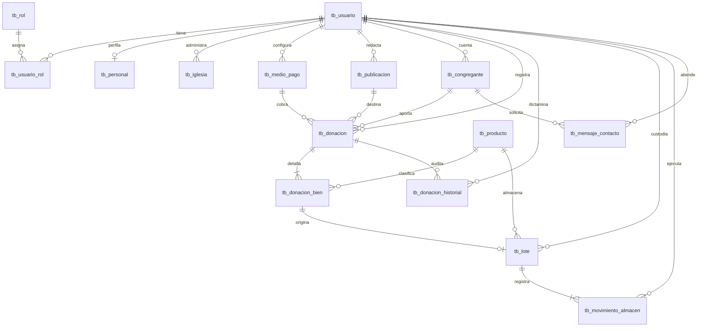

# INFORME TÉCNICO DE BASE DE DATOS: "SISTEMA IGLESIA MONTE DE ORACIÓN"
**Modelo Relacional Académico Puro (1FN, 2FN y 3FN)**

---

> ### 📌 NOTA ACLARATORIA PARA EL DOCENTE EVALUADOR
> **Este documento y el script adjunto `base_datos_academico.sql` representan el MODELO ACADÉMICO PURO DE BASE DE DATOS (Enfoque *Database-First*).**
>
> 1. **Propósito de esta entrega:** Diseñado con estricto rigor académico para sustentar la teoría formal de bases de datos relacionales: 15 tablas normalizadas en Tercera Forma Normal (3FN), integridad referencial completa, restricciones de dominio (`CHECK`, `UNIQUE`, `DEFAULT`), vistas analíticas y procedimientos almacenados transaccionales.
> 2. **Diferencia con el proyecto de software:** El software aplicativo web fue desarrollado en C# ASP.NET Core utilizando un framework ORM (*Entity Framework Core* y *ASP.NET Core Identity*). Los frameworks de software inyectan columnas técnicas de infraestructura web (como hashes criptográficos, tokens de sesión y marcas de concurrencia). Para evitar confusiones teóricas con el docente, **esta base de datos académica fue desacoplada al 100% de cualquier framework**, garantizando que el diseño relacional responda exclusivamente a las reglas de negocio de la institución.

---

## 1. Ficha Técnica de la Base de Datos Académica

* **Motor:** Microsoft SQL Server 2022 / Azure SQL Database.
* **Base de Datos:** `[MonteOracionAcademico]`
* **Script de Despliegue:** `base_datos_academico.sql` (100% puro Transact-SQL ejecutable en SSMS).
* **Número de Tablas:** Exactamente **15 tablas** interconectadas.
* **Convención de Nomenclatura:** Estándar académico tradicional:
  * Clave Primaria (PK): `id_nombretabla` (Ejemplo: `id_usuario`, `id_producto`, `id_donacion`).
  * Clave Foránea (FK): `id_nombretabla` (Idéntico nombre en la tabla hija para coincidencia exacta).
  * Claves subrogadas: `INT IDENTITY(1,1)` autoincrementales.
  * Tipos de datos estándar: `VARCHAR`, `DECIMAL(12,2)`, `DATETIME`, `DATE`, `BIT`.

---

## 2. Diagrama Entidad-Relación y Módulos del Negocio

El sistema se compone de 5 módulos funcionales que resuelven integralmente la operación de la iglesia:

---

## 3. Justificación de Normalización (1FN, 2FN, 3FN)

### Primera Forma Normal (1FN)
* **Atomicidad:** Cada columna contiene un único valor indivisible (por ejemplo: nombres y apellidos separados, direcciones y teléfonos atómicos).
* **Sin grupos repetitivos:** Los múltiples víveres de una donación física no se embuten en campos repetidos (`producto1`, `producto2`), sino que se trasladan a una entidad dependiente (`tb_donacion_bien`).
* **Clave Primaria definida:** Todas las tablas poseen una PK única.

### Segunda Forma Normal (2FN)
* Cumple la 1FN.
* **Dependencia funcional completa:** En tablas con clave primaria compuesta (como `tb_usuario_rol` con clave `[id_usuario, id_rol]`), no existen atributos descriptivos dependientes de solo una parte de la clave.

### Tercera Forma Normal (3FN)
* Cumple la 2FN.
* **Eliminación de dependencias transitivas:**
  * La información del colaborador no está dentro de `tb_usuario`; se aisló en `tb_personal`.
  * En `tb_donacion`, no se almacena el nombre del medio de pago ni la tasa; solo se guarda la clave foránea `id_medio_pago` hacia el catálogo maestro.
  * El catálogo de bienes (`tb_producto`) es independiente de las donaciones y los lotes, garantizando que un cambio en la descripción del producto no duplique registros.

---

## 4. Estructura Detallada de las 15 Tablas

### Módulo 1: Seguridad y Personal
1. **`tb_usuario`**: Catálogo limpio de usuarios autorizados para operar el software.
   * PK: `id_usuario` (INT IDENTITY)
   * Atributos: `nombre_usuario`, `clave`, `correo`, `telefono`, `activo`, `fecha_registro`.
2. **`tb_rol`**: Catálogo de perfiles del sistema (`Administrador`, `Recepción`, `Almacén`).
   * PK: `id_rol` (INT IDENTITY)
   * Atributos: `nombre_rol`, `descripcion`.
3. **`tb_usuario_rol`**: Tabla asociativa N:M que resuelve la asignación de perfiles.
   * PK Compuesta: (`id_usuario`, `id_rol`).
4. **`tb_personal`**: Ficha del personal ministerial y colaboradores.
   * PK: `id_personal` (INT IDENTITY) | FK: `id_usuario`.
   * Atributos: `nombre_completo`, `cargo`, `activo`.

### Módulo 2: Institución y Comunidad
5. **`tb_iglesia`**: Configuración legal y de contacto de la sede principal.
   * PK: `id_iglesia` (INT IDENTITY) | FK: `id_usuario`.
   * Atributos: `nombre_iglesia`, `ruc`, `direccion`, `telefono`, `correo`.
6. **`tb_medio_pago`**: Catálogo de cuentas receptoras de ofrendas (Yape, Plin, BCP, Efectivo).
   * PK: `id_medio_pago` (INT IDENTITY) | FK: `id_usuario`.
   * Atributos: `nombre_medio`, `tipo_medio`, `numero_cuenta`, `titular`, `activo`.
7. **`tb_publicacion`**: Eventos benéficos, vigilias y campañas pro-fondos.
   * PK: `id_publicacion` (INT IDENTITY) | FK: `id_usuario`.
   * Atributos: `titulo`, `tipo`, `descripcion`, `lugar`, `fecha_inicio`, `fecha_fin`, `meta_recaudacion`.
8. **`tb_congregante`**: Ficha de miembros activos y asistentes a la iglesia.
   * PK: `id_congregante` (INT IDENTITY) | FK: `id_usuario` (Opcional).
   * Atributos: `dni`, `nombres`, `apellidos`, `telefono`, `direccion`, `fecha_nacimiento`, `activo`.

### Módulo 3: Donaciones y Comprobantes
9. **`tb_producto`**: Catálogo maestro de bienes físicos (arroz, aceite, leche, fideos).
   * PK: `id_producto` (INT IDENTITY).
   * Atributos: `nombre_producto`, `categoria`, `unidad_medida`, `activo`.
10. **`tb_donacion`**: Cabecera maestra de aportes monetarios y materiales.
    * PK: `id_donacion` (INT IDENTITY) | FKs: `id_congregante`, `id_medio_pago`, `id_publicacion`, `id_usuario`.
    * Atributos: `codigo_seguimiento`, `tipo_donacion`, `estado`, `monto`, `numero_operacion`, `fecha_pago`.
11. **`tb_donacion_bien`**: Detalle de víveres y artículos donados físicamente.
    * PK: `id_donacion_bien` (INT IDENTITY) | FKs: `id_donacion`, `id_producto`.
    * Atributos: `descripcion`, `cantidad`, `unidad_medida`, `ubicacion_almacen`.
12. **`tb_donacion_historial`**: Registro de auditoría con la resolución de directiva.
    * PK: `id_historial` (INT IDENTITY) | FKs: `id_donacion`, `id_usuario`.
    * Atributos: `estado_resultado`, `motivo`, `fecha_decision`.

### Módulo 4: Almacén y Kardex
13. **`tb_lote`**: Control de stock físico clasificado por estante y estado de revisión.
    * PK: `id_lote` (INT IDENTITY) | FKs: `id_producto`, `id_donacion_bien`, `id_usuario`, `confirmado_por`.
    * Atributos: `ubicacion`, `origen`, `cantidad_actual`, `revision_pendiente`, `fecha_registro`.
14. **`tb_movimiento_almacen`**: Kardex físico de entradas, vistos buenos y salidas hacia comedores.
    * PK: `id_movimiento` (BIGINT IDENTITY) | FKs: `id_lote`, `id_usuario`.
    * Atributos: `tipo_movimiento`, `cantidad`, `motivo`, `destino`, `fecha_operacion`.

### Módulo 5: Consejería y Pastoral
15. **`tb_mensaje_contacto`**: Bandeja de solicitudes de oración y orientación espiritual.
    * PK: `id_mensaje` (INT IDENTITY) | FKs: `id_congregante`, `id_usuario`.
    * Atributos: `nombre_remitente`, `telefono`, `motivo`, `preferencia`, `mensaje`, `estado`, `fecha_atencion`.

---

## 5. Cuadro Comparativo: Modelo Académico vs. Versión de Software

| Elemento de Comparación | Base de Datos Académica (`MonteOracionAcademico`) | Base de Datos de Aplicativo Web (`MonteOracionApp`) |
| :--- | :--- | :--- |
| **Metodología de Diseño** | **Database-First Puro:** Se diseñó primero el MER y el script SQL a mano. | **Code-First:** El ORM genera el esquema a partir de clases C#. |
| **Identificadores (PK/FK)** | `id_tabla` uniforme tipo entero (`INT IDENTITY`). | `Id` en tabla propia y tipos mixtos (`NVARCHAR(450)` en Identity). |
| **Tabla de Usuarios** | Solo 7 atributos de negocio: usuario, clave, correo, teléfono, activo. | Incluye atributos criptográficos: `sello_seguridad`, `bloqueo_activo`, etc. |
| **Tabla de Roles** | Solo `id_rol`, `nombre_rol` y `descripcion`. | Incluye `nombre_normalizado` y `sello_concurrencia` para Identity. |
| **Concurrencia** | Gestionada mediante transacciones ACID (`BEGIN TRANSACTION / COMMIT`). | Gestionada mediante columnas binarias `ROWVERSION`. |
| **Independencia** | **100% independiente:** Corre en cualquier SQL Server sin instalar código. | Acoplada al runtime de .NET 10 y bibliotecas de Entity Framework. |

---

## 6. Guía de Sustentación ante el Docente

Si el jurado o docente formula las siguientes preguntas durante la evaluación:

1. **¿Por qué la clave foránea se llama igual que la clave primaria?**  
   * *Respuesta:* *"Para mantener la homogeneidad semántica del modelo relacional. En la tabla padre `tb_producto` la clave es `id_producto`, y en la tabla hija `tb_donacion_bien` se conserva como `id_producto` para identificar de inmediato la procedencia de la relación sin requerir alias confusos."*
2. **¿Cómo garantizan que una donación no se duplique?**  
   * *Respuesta:* *"Mediante una restricción de unicidad (`UNIQUE`) sobre el código de seguimiento autogenerado y el control transaccional del procedimiento almacenado `sp_registrar_donacion_monetaria`, que verifica la no existencia del número de operación en el mismo día."*
3. **¿Por qué el kardex admite cantidades negativas?**  
   * *Respuesta:* *"Porque implementa la técnica estándar de inventario por partida doble: las entradas suman stock positivo y las salidas hacia comedores sociales registran una cantidad negativa con restricción `CHECK ([cantidad] <> 0)`, permitiendo calcular el saldo final mediante una simple función `SUM(cantidad)`."*

---
*Documento elaborado para sustentar el curso de Gestión y Administración de Bases de Datos.*
